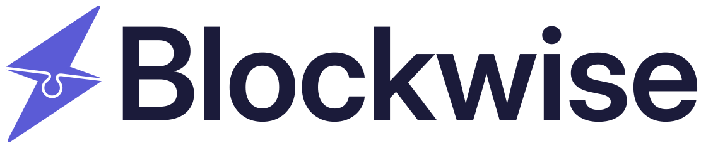
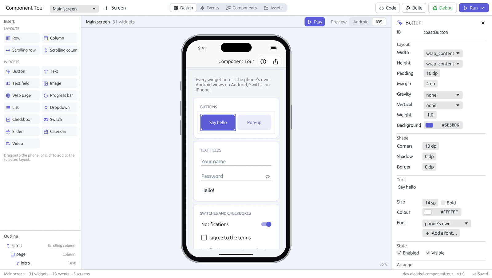
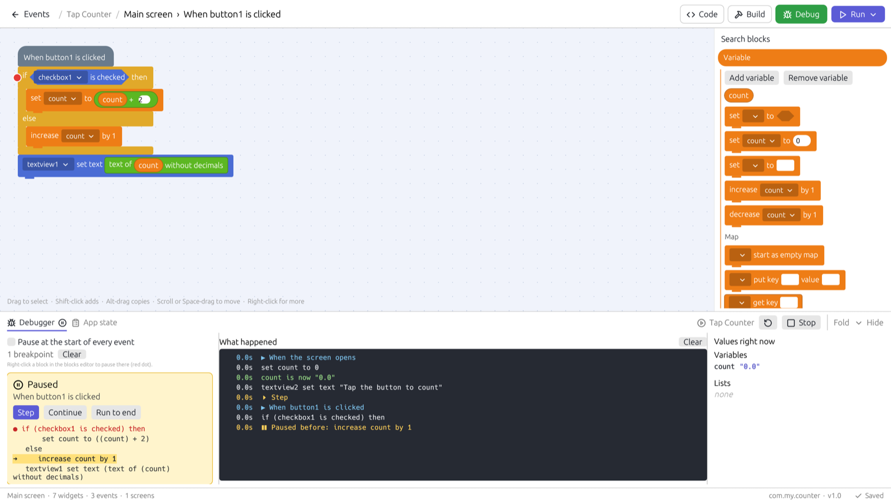
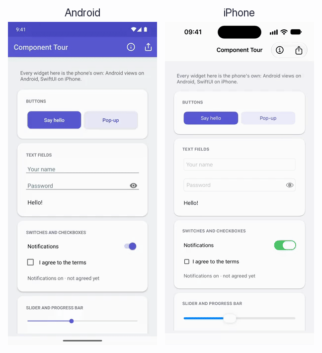
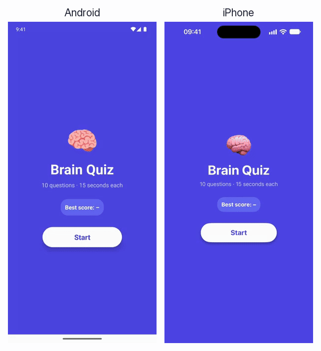
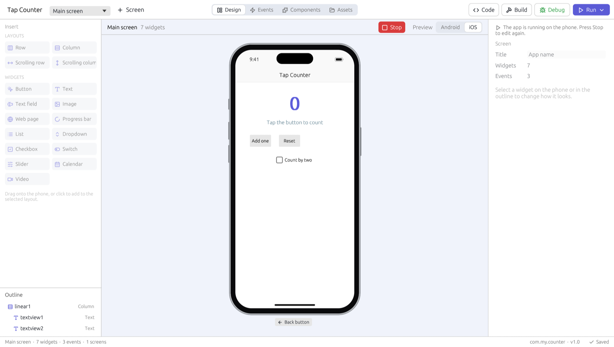

<h1 align="center">
  <picture>
    <source media="(prefers-color-scheme: dark)" srcset="brand/logo-wordmark-on-dark.svg">
    
  </picture>
</h1>

**Build real Android and iOS apps without writing code.** Design your screens by dragging widgets onto a phone, make them do things by snapping blocks together, and try the app at once, right in the editor. When it's ready, Blockwise gives you a real Kotlin project for Android Studio and a SwiftUI project for Xcode, or runs the app on the Android emulator and the iPhone simulator for you.



## What you can do

- **Design screens.** Rows, columns, text, buttons, text fields (password, email, number, phone…), images, lists, dropdowns, checkboxes, switches, sliders, calendars, videos and web pages. Set sizes, spacing, colours, corners, shadows and fonts in the inspector.
- **Add behaviour with blocks.** Pick an event ("When button1 is clicked"), then build its logic from ten block categories: variables, lists, control, operators, math, saved data, views, components, your own reusable blocks, and Supabase.
- **Press Play.** The phone in the designer runs your app. Tap buttons, type in fields, watch videos, hear sounds, with no build and no wait.
- **Debug it.** Set breakpoints on blocks, step through them, and watch your variables change in the debugger at the bottom of the window.
- **Run it on a phone.** One click builds and launches the app on the Android emulator or the iOS simulator. The first time, Blockwise offers to download the Android tools for you.
- **Get the code.** Export a native Kotlin + XML Android project and a SwiftUI iOS project, both readable and yours to keep.
- **Sign people in and store data** with [Supabase](https://supabase.com), using ready-made blocks and screen templates.
- **Work with an AI assistant.** Blockwise speaks [MCP](https://modelcontextprotocol.io), so an assistant such as Claude can build screens and blocks in the open window with you.



## Examples

Blockwise comes with example apps: open **Examples** in the left column and press **Open a copy**. Here they are running on the Android emulator and the iPhone simulator. Every widget is the phone's own, generated from the same blocks.

| Component Tour | Brain Quiz |
| :---: | :---: |
|  |  |
| Every native widget in one app, with app bar buttons, a pop-up, a bottom sheet, a calendar and a list. | Ten questions from a JSON file, a timer, green and red answers, and a saved best score. |
| [Android app](https://github.com/aabouqas/Blockwise/releases/latest/download/component-tour.apk) | [Android app](https://github.com/aabouqas/Blockwise/releases/latest/download/brain-quiz.apk) |

More about them in [examples](examples/README.md).

## Getting started

### Download

Get Blockwise for macOS, Windows or Linux from the [latest release](https://github.com/aabouqas/Blockwise/releases/latest):

- **macOS 11 or later** (Apple silicon and Intel): open the `.dmg` and drag Blockwise into Applications. The app isn't signed with an Apple Developer ID yet, so the first time, macOS won't open it: go to **System Settings › Privacy & Security** and press **Open Anyway**.
- **Windows:** unzip it and run `Blockwise.exe`. If SmartScreen warns you, press **More info**, then **Run anyway**.
- **Linux** (x86_64): unpack the `.tar.gz` and run `Blockwise`.

### Build from source

1. Install Rust from [rustup.rs](https://rustup.rs).
2. Get the code and build it:

   ```bash
   git clone <this repository> blockwise
   cd blockwise/app
   cargo build --release
   ```

3. Start it (still in `app/`):

   ```bash
   ./target/release/Blockwise
   ```

To run apps on a phone:

- **Android:** nothing to install by hand. The first time you run an app, Blockwise asks before downloading Java, the Android SDK, Gradle and an emulator (about 2.4 GB). If you already have Android Studio, Blockwise uses its tools.
- **iOS (macOS only):** install Xcode with an iOS simulator. Generated apps target iOS 17.

Then read the [user guide](docs/user-guide.md).



## Documentation

- [User guide](docs/user-guide.md): projects, screens, the designer, events and blocks, components, assets, debugging, running and exporting.
- [AI assistants (MCP)](docs/ai-assistants.md): let an assistant build alongside you.
- [How Blockwise is built](docs/architecture.md): a one-page map of the code.
- [Developer guide](docs/developer/README.md): how each part works, how to test, and step-by-step recipes for common changes.
- [Contributing](CONTRIBUTING.md) and [security](SECURITY.md).

## Platforms

Blockwise is developed and tested on macOS. The code also has paths for Linux and Windows (Android only, since iOS tools need a Mac), but those builds are not tested yet. Reports and fixes are welcome.

## License

Copyright 2026 Aissam Abouqassime El Edrissi.

Blockwise is licensed under the [Apache License 2.0](LICENSE). See [NOTICE](NOTICE) and [THIRD_PARTY.md](THIRD_PARTY.md) for the parts made by others.

**The apps you make are yours.** The projects you build and the code Blockwise generates from them belong to you, under any license you choose, commercial or not. [NOTICE](NOTICE) says so formally.

The Blockwise name and logo (`brand/` and `app/assets/brand/`) are not covered by the license. Forks should use their own name and logo.

Android is a trademark of Google LLC. iPhone, iOS, Swift and Xcode are trademarks of Apple Inc. Blockwise is not affiliated with Google or Apple.
