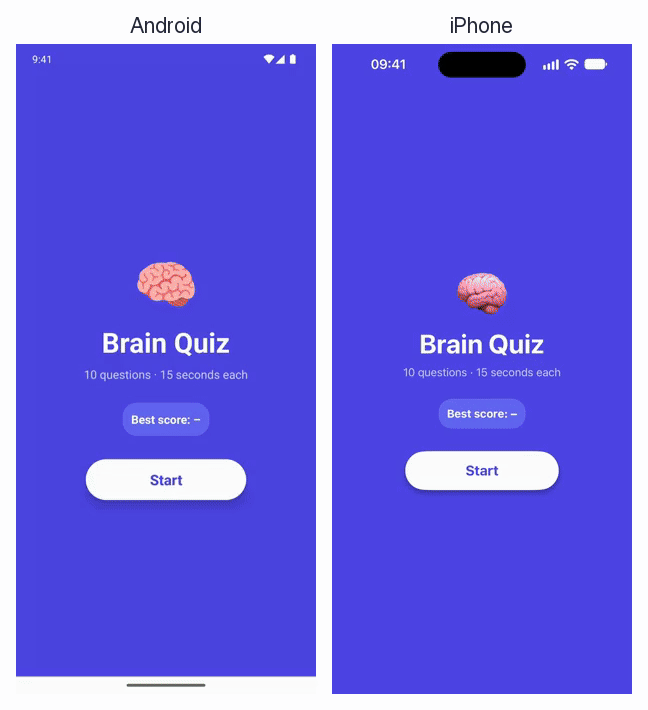

# Examples

Apps made with Blockwise, recorded on the Android emulator and the iPhone simulator. Every widget is the phone's own: Android views in the Kotlin app, SwiftUI in the iPhone app, both generated from the same blocks.

Each example is a `.bw` file: a whole project, with its pictures and data files, in one file. Download one and double-click it, and Blockwise opens it as a new project. You can also drop it on the Blockwise window, or use **Import project…** (⌘O). The examples also come with Blockwise: open **Examples** in the left column and press **Open a copy**.

To try one on an Android phone without Blockwise, download its APK on the phone and open it.

## Component Tour


Every native widget in one app: buttons, a message and a pop-up, text fields, a switch and a checkbox, a slider driving a progress bar, a dropdown, a bottom sheet, a calendar and a list. The app bar has an info button and a share button.

- [Download the project (component-tour.bw)](https://github.com/aabouqas/Blockwise/raw/main/examples/component-tour.bw)
- [Download the Android app](https://github.com/aabouqas/Blockwise/raw/main/examples/component-tour.apk)

## Brain Quiz



Ten random questions read from a JSON file, a 15-second bar counting down on each one, green and red answers, and a best score saved on the phone. Change the questions by editing `questions.json` in the project's **Assets**.

- [Download the project (brain-quiz.bw)](https://github.com/aabouqas/Blockwise/raw/main/examples/brain-quiz.bw)
- [Download the Android app](https://github.com/aabouqas/Blockwise/raw/main/examples/brain-quiz.apk)

## Changing an example

Edit your copy in Blockwise like any project. To change the example itself (the file here, which Blockwise also builds in), make the change in Blockwise, save it over the example, and rebuild Blockwise:

```bash
python3 app/export_example.py <project id> brain-quiz --glyph brain --color FF7C4DFF
```

Then make its APK again: in the project's **⋯** menu press **Build APK**, and copy the `.apk` it saves (in `Documents/Blockwise builds`) here as `brain-quiz.apk`.

The APKs aren't signed for the Play Store; Android asks to allow installing apps from your browser or file manager the first time.
