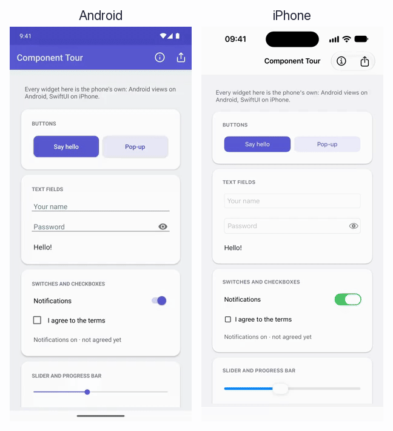

# Examples

Apps made with Blockwise, recorded on the Android emulator and the iPhone simulator. Every widget is the phone's own: Android views in the Kotlin app, SwiftUI in the iPhone app, both generated from the same blocks.

Each example comes with Blockwise: open **Examples** in the left column and press **Open a copy**. You can also download an example's `.bw` file and open it with **Import project…** (⌘O), or drop it on the Blockwise window. To try one on an Android phone without Blockwise, download its APK.

## Component Tour



Every native widget in one app: buttons, a message and a pop-up, text fields, a switch and a checkbox, a slider driving a progress bar, a dropdown, a bottom sheet, a calendar and a list. The app bar has an info button and a share button.

- [Download the Android app](https://github.com/aabouqas/Blockwise/releases/latest/download/component-tour.apk)
- [The project as a .bw file](component-tour/component-tour.bw) ([project.json](component-tour/project.json))

## Brain Quiz


Ten random questions read from a JSON file, a 15-second bar counting down on each one, green and red answers, and a best score saved on the phone. Change the questions by editing [questions.json](brain-quiz/assets/questions.json) in the project's Assets.

- [Download the Android app](https://github.com/aabouqas/Blockwise/releases/latest/download/brain-quiz.apk)
- [The project as a .bw file](brain-quiz/brain-quiz.bw) ([project.json](brain-quiz/project.json), [assets](brain-quiz/assets))

## Changing an example

Edit the copy in Blockwise like any project. To change the example itself (what Blockwise comes with), make the change in Blockwise, then copy it back here and rebuild Blockwise:

```bash
python3 examples/export.py <project id> brain-quiz --glyph brain --color FF7C4DFF
```

The APKs aren't signed for the Play Store; Android asks to allow installing apps from your browser or file manager the first time.
